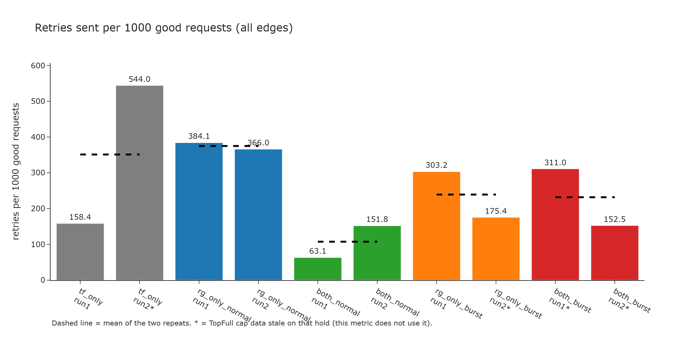
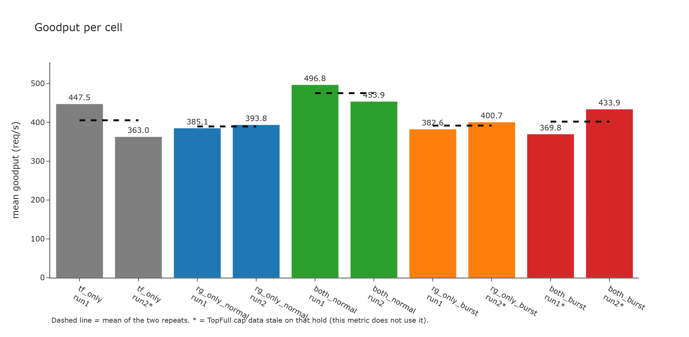
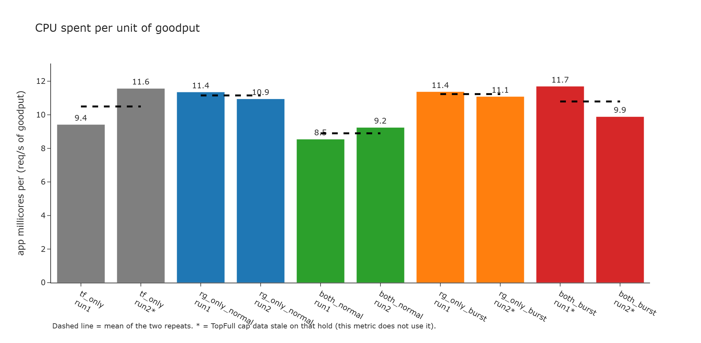
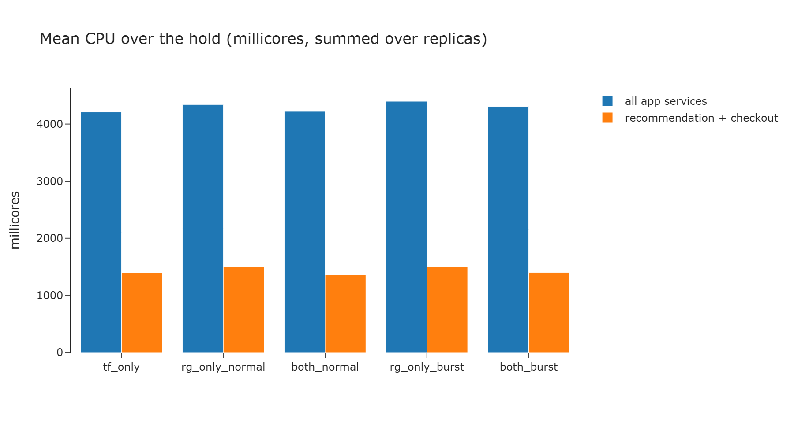
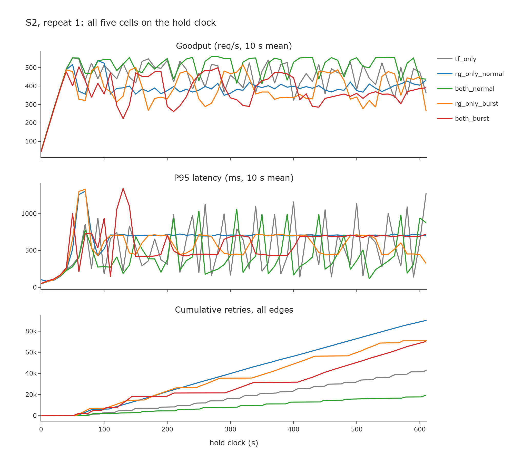
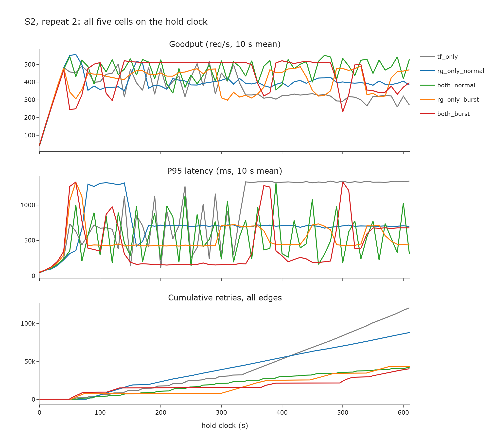

# S2 cost efficiency: does RetryGuard waste fewer retries and less CPU per unit of goodput?

**Superseded by [2026-10-15-s2-controller-activation-analysis.md](2026-10-15-s2-controller-activation-analysis.md).** This page compares cells without checking whether each controller acted. Keep it only for the per-hold cost table.

Question for the professor: on Scenario 2 (sustained overload), is RetryGuard cost efficient? Cost is read two ways: retries sent per good request, and CPU spent per unit of goodput.

**Short answer.** The `both_normal` holds have fewer retries and higher goodput than TopFull alone, but RetryGuard never changed the retry policy on either of them. Attempts stayed at 3 for the whole 600 s, the same policy as `tf_only`. That gap is not a RetryGuard result. On the two holds where RetryGuard did turn retries off (`both_burst`), the cost numbers do not beat `tf_only` in both repeats. RetryGuard also does not reduce absolute CPU.

## Setup

The ten holds of the locked S2 mode matrix (2026-10-14), 600 s each, mix 275 / 90 / 100 / 90 / 5, `spawn_rate` 50, Paper-C1 CPU table, frontend pinned at 4 replicas. Full tables and the per-edge reading are in [2026-10-14-s2-mode-matrix-abc.md](2026-10-14-s2-mode-matrix-abc.md). Folders are under `experiments/results/final results/S2_sustained_overload_{normal,burst}/`.

Five cells, two repeats each:

| Cell | RetryGuard | TopFull | Holds |
| --- | --- | --- | --- |
| `tf_only` | off | on | `final_s2_tf_only_run1`, `run2` |
| `rg_only_normal` | normal | off | `final_s2_rg_only_normal_run1`, `run2` |
| `both_normal` | normal | on | `final_s2_both_normal_run1`, `run2` |
| `rg_only_burst` | burst 2.0 | off | `final_s2_rg_only_burst_run1`, `run2` |
| `both_burst` | burst 2.0 | on | `final_s2_both_burst_run1`, `run2` |

There is no both-off S2 hold in this matrix. "Cost efficient" here means against `tf_only`, not against no controller at all.

## How the numbers are computed

Script: [experiments/s2_cost_efficiency.py](../experiments/s2_cost_efficiency.py). Output table: [2026-10-15-s2-cost-efficiency/cost_table.csv](2026-10-15-s2-cost-efficiency/cost_table.csv).

- **Goodput.** Mean `Goodput` of `total.csv` over the hold (all five APIs, includes the ramp-up).
- **Retries per 1000 good requests.** Sum of positive per-poll increases of the Envoy `retry` counter over every caller to callee edge in `service_edges.csv`, divided by (mean goodput x hold seconds) x 1000. The first row of each edge and any backward step add nothing, the same rule as graphs_tool. The hot edge `frontend to recommendationservice` reproduces the guide's retry delta exactly (for example 17,142 and 41,840 on `both_normal`).
- **CPU per goodput.** Mean over the hold of `cpu_millicores` summed over replicas and over all Boutique services (master VM excluded), divided by mean goodput.

## Results

Per cell, mean [min, max] over the two repeats:

| Cell | Goodput req/s | SLO-miss | P95 ms | Retries per 1k good | Hot-edge retries | App mc per req/s |
| --- | ---: | ---: | ---: | ---: | ---: | ---: |
| `tf_only` | 405 [363, 448] | 0.183 | 715 | 351 [158, 544] | 81,729 | 10.50 [9.42, 11.57] |
| `rg_only_normal` | 389 [385, 394] | 0.253 | 688 | 375 [366, 384] | 89,142 | 11.15 [10.95, 11.35] |
| `both_normal` | **475 [454, 497]** | **0.088** | **473** | **108 [63, 152]** | **29,491** | **8.90 [8.55, 9.25]** |
| `rg_only_burst` | 392 [383, 401] | 0.255 | 547 | 239 [175, 303] | 56,874 | 11.23 [11.09, 11.38] |
| `both_burst` | 402 [370, 434] | 0.227 | 506 | 232 [153, 311] | 55,260 | 10.79 [9.89, 11.70] |

The hold-clock views, all five cells on one axis per repeat:

In both timelines the `both_normal` line (green) has the flattest cumulative retry curve and the highest goodput, while the `rg_only_normal` line (blue) climbs steadily. In repeat 2 `tf_only` (grey) falls to about 300 req/s with P95 near 1300 ms from about 340 s on, and its retry curve passes everything else.

### The interactive comparison pages (multi_graphs_tool)

Four pages built with `python experiments/multi_graphs_tool.py <tf_only> <rg_only> <both>`, in `experiments/explore_out/` (git-ignored, open in a browser). In each, turn on Goodput, P95, Cumulative retries, Retries per request, Attempts and CPU from the legend:

- `multi_final_s2_tf_only_run1__final_s2_rg_only_normal_run1__final_s2_both_normal_run1.html`
- `multi_final_s2_tf_only_run1__final_s2_rg_only_burst_run1__final_s2_both_burst_run1.html`
- `multi_final_s2_tf_only_run2__final_s2_rg_only_normal_run2__final_s2_both_normal_run2.html`
- `multi_final_s2_tf_only_run2__final_s2_rg_only_burst_run2__final_s2_both_burst_run2.html`

Shared y per unit means equal heights are equal values across panels. Rebuild them with the commands in [GRAPHS-TOOL.md](GRAPHS-TOOL.md) if they are missing.

## Verdict per cell, against `tf_only`

| Claim | Verdict | Why |
| --- | --- | --- |
| `both_normal`: RetryGuard saved retries or raised goodput | **Not a RetryGuard result** | The numbers are lower (63 and 152 retries per 1k good, against 158 and 544) and goodput is higher (497 and 454 against 448 and 363). `retryguard.log` on both holds has a `START` line and no `ON→OFF`, `OFF→ON`, `1→2`, or `2→3`. Attempts stayed at 3, so the actuator never moved. The retry policy matched `tf_only`. |
| `both_normal`: less CPU per goodput | **Not a CPU saving** | 8.5 and 9.2 against 9.4 and 11.6 mc per req/s. Absolute CPU is the same, and RetryGuard did not act. |
| `both_burst`: fewer retries or better goodput | **Inconclusive** | Retries 311 and 153 against 158 and 544: better in run 2 only. Goodput 370 and 434 against 448 and 363: better in run 2 only. |
| `rg_only_normal` | **Not supported** | Retries 384 and 366 against 158 and 544 (no saving on average). Goodput 385 and 394 against 448 and 363 (mixed). SLO-miss (0.253) is among the two worst of the five. |
| `rg_only_burst` | **Inconclusive** | Retries 303 and 175 against 158 and 544: mixed. Goodput 383 and 401 against 448 and 363: mixed. |
| RetryGuard reduces CPU | **Not supported** | Summed app CPU is 4,197 to 4,443 mc on all ten holds, a spread under 6%. The `rg_only` holds are slightly higher (4,311 to 4,443) than `tf_only` (4,201 to 4,217). |

## Why the table cannot go further

- **Two repeats per cell.** `tf_only` alone spans 158 to 544 retries per 1k good between its two repeats. That spread is larger than most of the gaps between cells. A claim stronger than "consistent in both repeats" needs more repeats (the five S2 YAMLs are at run 3 in [STATUS.md](../STATUS.md) Next free slots).
- **`both_normal` is not evidence for RetryGuard.** RetryGuard was running and never shed. Crediting it for the lower retry count treats two quieter TopFull holds as a controller effect. `tf_only` alone already spans 158 to 544 retries per 1k good, and the best `tf_only` hold (158) sits next to the worse `both_normal` hold (152).
- **Where RetryGuard did act, the cost claim does not hold.** `both_burst_run1` shed `frontend → recommendationservice` three times (rpr 1.19, 0.72 burst, 0.51) and ended at 1 attempt. `both_burst_run2` shed that edge four times (rpr 1.57, 0.57, 0.46, 1.20). Those two holds are 311 and 153 retries per 1k good, against 158 and 544 for `tf_only`: better in one repeat only. The `rg_only` holds, where RetryGuard also shed, do not beat `tf_only` either.
- **Throttle FLAG holds.** `final_s2_tf_only_run2`, `final_s2_rg_only_burst_run2`, `final_s2_both_burst_run1` and `final_s2_both_burst_run2` are flagged for stale TopFull cap reads. The numbers above do not use `topfull_throttle.csv`, so they stay valid. The cap and admitted-rate lines on those four holds must not be shown as measured. `final_s2_rg_only_burst_run2` has TopFull off, so it has no cap to lose.
- **Goodput includes the ramp-up** and is the five-API sum. The guide's per-API goodput table is the stricter reading and points the same way for `getproduct` (250 and 226 for `both_normal`, 221 and 171 for `tf_only`).
- **CPU per goodput is mostly goodput.** Absolute CPU barely moves, so that ratio mostly restates the goodput gain. Do not present it as a separate saving.

## Related

[2026-10-14-s2-mode-matrix-abc.md](2026-10-14-s2-mode-matrix-abc.md) (full scorer tables), [GRAPHS-TOOL.md](GRAPHS-TOOL.md), [ANALYSIS-TEMPLATE.md](ANALYSIS-TEMPLATE.md), [2026-10-13-controller-vs-scorer-rejection.md](2026-10-13-controller-vs-scorer-rejection.md).
