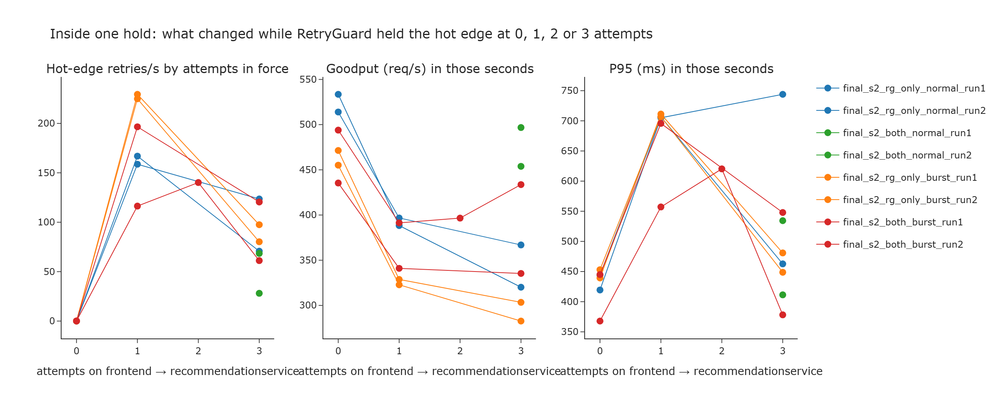
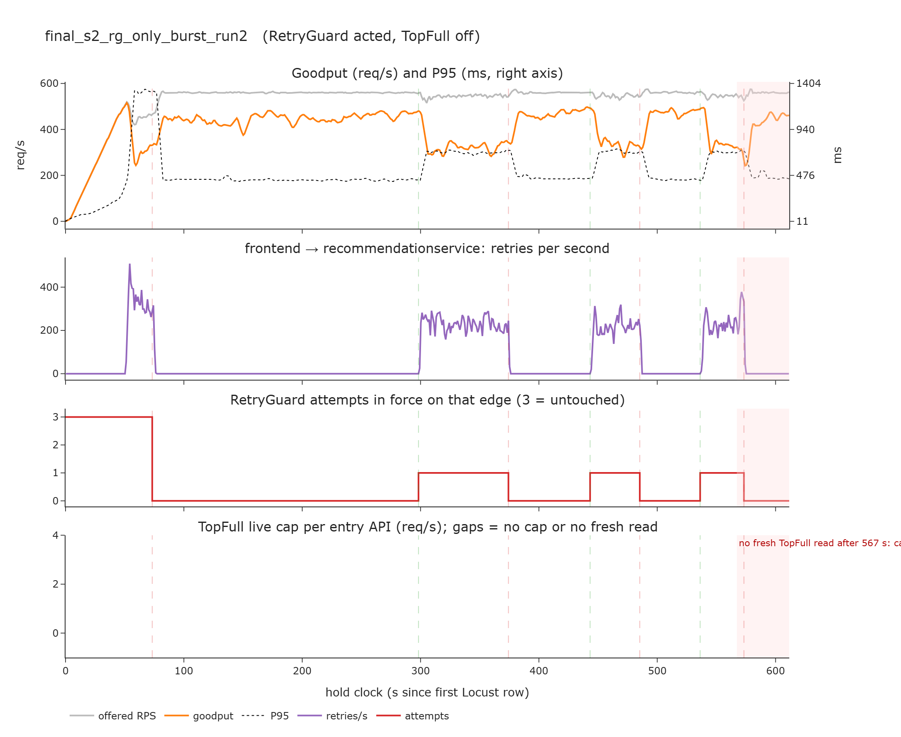
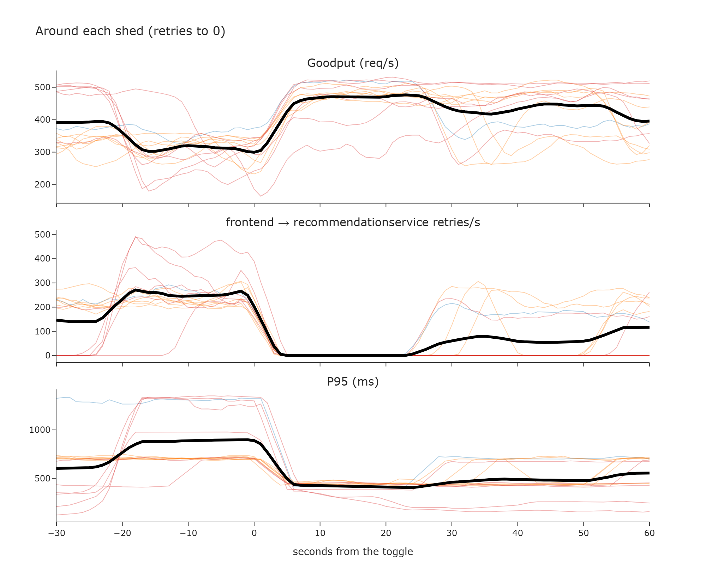
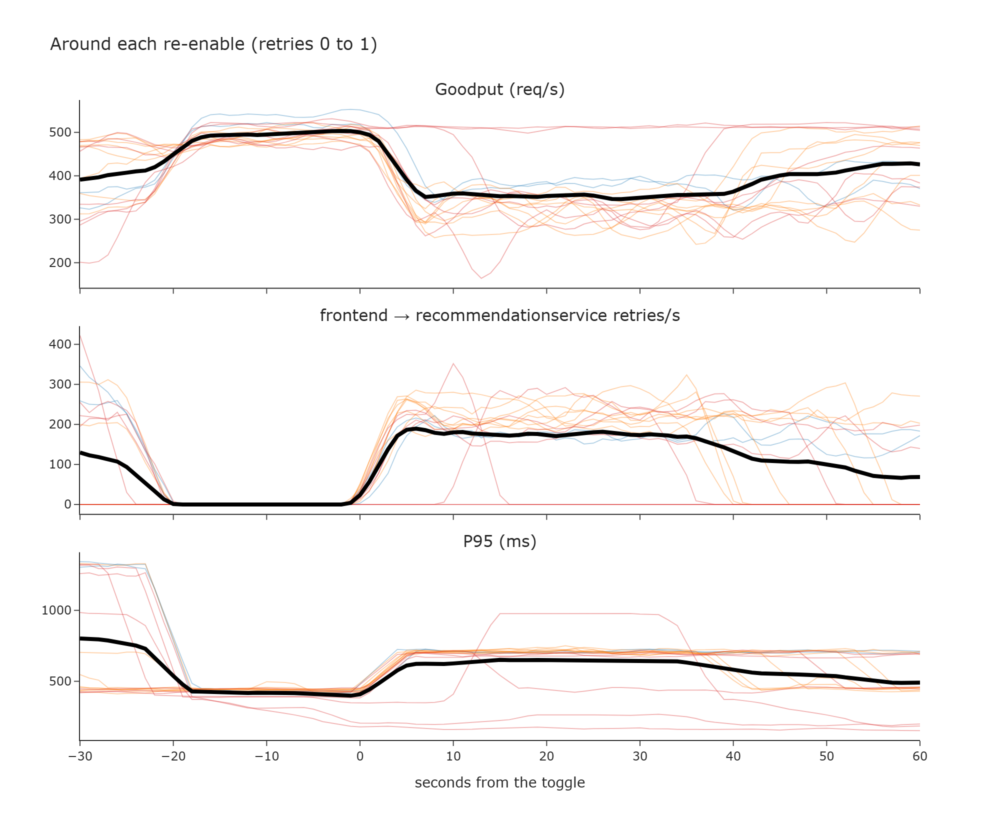
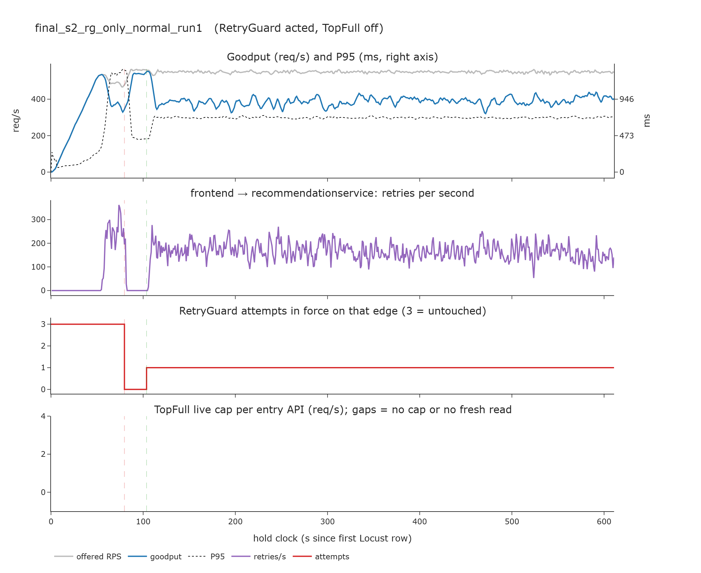
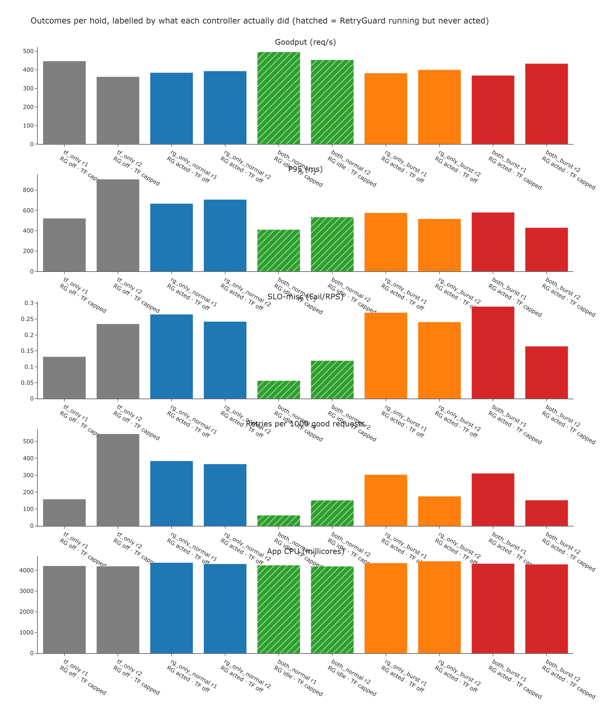
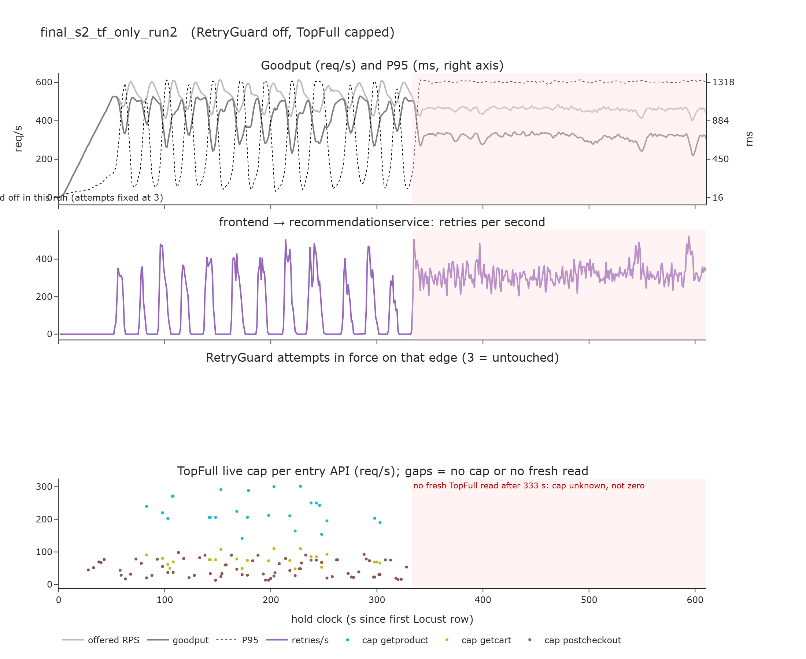

# S2 mode matrix, read by what each controller actually did

The ten locked S2 holds (2026-10-14), re-analysed so that every claim names a controller that actually moved its actuator. "Running" is not "acting". This replaces the verdicts in [2026-10-15-s2-cost-efficiency.md](2026-10-15-s2-cost-efficiency.md), which compared cells without checking activation.

## The conclusions

1. **Turning retries off on `frontend → recommendationservice` helps a lot, every time it happens.** Inside the same hold at the same load, seconds with retries off beat seconds with one retry in all six holds where RetryGuard acted. Goodput is 435–534 req/s against 323–397, P95 368–453 ms against 557–711 ms, and SLO-miss 0.05–0.22 against 0.28–0.41. Around 14 sheds, mean goodput rises from 336 to 469 req/s and P95 falls from 816 to 421 ms; 13 of the 14 go that way. Around 17 re-enables, goodput falls from 471 to 355 req/s and P95 rises from 499 to 641 ms; 15 of the 17 go that way.
2. **RetryGuard's policy gives most of that gain back.** After a shed it re-enables at 1 attempt once rejection has been low for 20 s, and the overload comes straight back. In normal mode it then stays at 1 attempt for 71–83% of the hold. There the retry ratio (0.35–0.37) sits between the climb bar (0.16) and the shed bar (0.40), so it neither sheds again nor climbs. That is why the hold-level numbers barely move.
3. **Comparing cells at hold level cannot answer "is RetryGuard better" with two repeats.** Four holds ran the same effective policy: TopFull on, retries at 3 the whole time (`tf_only` ×2, and `both_normal` ×2, where RetryGuard ran but never acted). They span goodput 363–497 req/s, P95 411–907 ms, and 63–544 retries per 1000 good requests. That spread is larger than any gap between cells.
4. **TopFull acts on checkout, not on recommendations.** On every TopFull hold where its caps could be read, it capped `postcheckout` for most of the hold (76–90%), and `getproduct` and `getcart` only 1–23% of the time. Checkout was detector-hot 62–81% of the time with TopFull on and 91–95% with it off, on all ten holds. RetryGuard's only target, `recommendationservice`, sits behind the browse APIs that TopFull rarely capped. In S2 the two controllers mostly act on different services.
5. **TopFull went blind mid-hold on three of its six holds, and `tf_only_run2` collapsed at that moment.** The proxy's admin endpoints timed out, so the collector got no fresh cap reads after 333 s (`tf_only_run2`), 120 s (`both_burst_run1`), and 47 s (`both_burst_run2`). On `tf_only_run2`, goodput went from 425 to 316 req/s and P95 from 634 to 1324 ms at that moment. The cap-driven oscillation also stopped, and checkout's detector-hot share rose from 0.45 to 0.79. That pattern fits TopFull's control loop stalling, but the data cannot prove it.
6. **Normal against burst is confounded twice.** The burst detector fired only 4 of the 18 sheds in the burst holds; the rest came from the normal 0.40 bar. In the burst holds the retry ratio at 1 attempt was 0.45–0.51, above the 0.40 bar, so RetryGuard re-shed instead of sticking. That is a different depth of overload, not burst mode. The burst holds also ran last (12:18 to 13:25). The four throttle-flagged holds are the 6th, 8th, 9th, and 10th by start time, so session order and proxy health line up with the cell.
7. **CPU is not a lever here.** Summed app CPU is 4,197–4,444 millicores on all ten holds, and the CPU limits are fixed. Any "cost per goodput" is just the goodput number restated.
8. **RetryGuard watching without acting costs nothing visible.** `both_normal` sits inside the `tf_only` range on every metric.

## Setup

Ten holds, 600 s each, mix 275 / 90 / 100 / 90 / 5, `spawn_rate` 50, Paper-C1, frontend pinned at 4. Folders are under `experiments/results/final results/S2_sustained_overload_{normal,burst}/`. The scorer tables are in [2026-10-14-s2-mode-matrix-abc.md](2026-10-14-s2-mode-matrix-abc.md).

Script: [experiments/s2_activation_analysis.py](../../experiments/s2_activation_analysis.py). The interactive page is `experiments/explore_out/s2_activation/s2_activation.html` (git-ignored; rebuild with `python experiments/s2_activation_analysis.py`). CSVs and PNGs are in [2026-10-15-s2-controller-activation/](2026-10-15-s2-controller-activation/).

Definitions:

- **RetryGuard acted** = at least one `ON→OFF`, `OFF→ON`, `1→2`, or `2→3` line in `retryguard.log`. Attempts on the hot edge come from those lines, because `OBSERVE` lines for an edge stop while it is shed.
- **TopFull capped** = a fresh read (`threshold_fresh=1`) with a threshold above 0 and below 10000. Each live read covers the next 6 s. "Fresh-read coverage" is the share of the hold with any fresh proxy read; outside it, the cap is unknown, not zero.
- **Settled seconds** drop the 3 s after each attempts change, while Envoy picks up the VirtualService patch.

## Activation per hold

| Hold | RetryGuard | Sheds / re-enables / climbs | Hot edge s at 0 / 1 / 2 / 3 attempts | TopFull | Fresh-read coverage | Cap share postcheckout / getproduct / getcart | Checkout detector-hot |
| --- | --- | --- | --- | --- | ---: | --- | ---: |
| `tf_only_run1` | off | — | 0 / 0 / 0 / 611 | capped | 99% | 90% / 23% / 21% | 74% |
| `tf_only_run2` | off | — | 0 / 0 / 0 / 610 | capped | **55%** | 48% / 19% / 19% | 67% |
| `rg_only_normal_run1` | **acted** | 1 / 1 / 0 | 24 / 506 / 0 / 80 | off | — | — | 95% |
| `rg_only_normal_run2` | **acted** | 1 / 1 / 0 | 24 / 434 / 0 / 152 | off | — | — | 95% |
| `both_normal_run1` | running, **never acted** | 0 / 0 / 0 | 0 / 0 / 0 / 610 | capped | 99% | 76% / 1% / 1% | 81% |
| `both_normal_run2` | running, **never acted** | 0 / 0 / 0 | 0 / 0 / 0 / 610 | capped | 100% | 83% / 15% / 15% | 72% |
| `rg_only_burst_run1` | **acted** | 7 / 6 / 0 | 247 / 287 / 0 / 77 | off | — | — | 91% |
| `rg_only_burst_run2` | **acted** | 4 / 3 / 0 | 382 / 155 / 0 / 74 | off | — | — | 91% |
| `both_burst_run1` | **acted** | 3 / 3 / 0 | 202 / 265 / 0 / 143 | capped | **20%** | 15% / 5% / 5% | 72% |
| `both_burst_run2` | **acted** | 4 / 4 / 5 | 101 / 103 / 44 / 362 | capped | **8%** | 3% / 0% / 0% | 62% |

Every shed and re-enable in the matrix is on `frontend → recommendationservice`. The 3-attempt seconds on RetryGuard holds are mostly the first 60–80 s (the ramp before the first shed), so they are not used as a comparison.

## Evidence for conclusion 1: the actuator

### Same hold, same load, by attempts in force

| Hold | Attempts | Settled s | Hot-edge retries/s | Goodput req/s | P95 ms | SLO-miss |
| --- | ---: | ---: | ---: | ---: | ---: | ---: |
| `rg_only_normal_run1` | 0 | 21 | 0 | **534** | **444** | **0.05** |
| | 1 | 505 | 167 | 388 | 707 | 0.29 |
| `rg_only_normal_run2` | 0 | 21 | 0 | **514** | **419** | **0.08** |
| | 1 | 433 | 159 | 397 | 705 | 0.28 |
| `rg_only_burst_run1` | 0 | 228 | 0 | **471** | **453** | **0.16** |
| | 1 | 269 | 225 | 329 | 707 | 0.40 |
| `rg_only_burst_run2` | 0 | 372 | 0 | **455** | **439** | **0.19** |
| | 1 | 146 | 229 | 323 | 711 | 0.41 |
| `both_burst_run1` | 0 | 194 | 0 | **435** | **445** | **0.22** |
| | 1 | 257 | 197 | 341 | 696 | 0.38 |
| `both_burst_run2` | 0 | 90 | 0 | **494** | **368** | **0.12** |
| | 1 | 94 | 116 | 391 | 557 | 0.29 |

### The cleanest single hold

`rg_only_burst_run2` has TopFull off, so nothing else is changing the system, and the offered load is flat. Each switch between 0 and 1 attempts flips goodput between about 450 and 300 req/s and P95 between about 470 and 880 ms, in both directions, four times.

### Event study

Every toggle on the hot edge at least 60 s into the hold and 60 s before its end. The comparison is the mean over 5–25 s after the toggle against 25–5 s before it.

| | Events | Goodput before → after | Hot-edge retries/s | P95 ms | Same direction |
| --- | ---: | --- | --- | --- | --- |
| Shed (retries to 0) | 14 | 336 → **469** | 231 → 0 | 816 → **421** | 13 of 14 |
| Re-enable (0 to 1) | 17 | 471 → 355 | 13 → 177 | 499 → 641 | 15 of 17 |

The one shed that went the other way is `both_burst_run1` #2, the only burst-detector shed in that hold, taken while goodput was already 448 req/s. The two re-enables that went the other way are `both_burst_run2` #2 and #3. There the overload had already passed, retries did not come back at 1 attempt, and RetryGuard then climbed to 3.

**Limit.** Sheds are triggered at high retry ratios and re-enables at low rejection, so each event is picked at an extreme. Regression to the mean could explain part of a single event. Three things argue against it being the main effect. The TopFull-off holds sit on a flat plateau at 1 attempt for hundreds of seconds with no swing of their own (see `rg_only_normal_run1` below). The jump lines up with the toggle to within the 3–5 s Envoy takes to apply the patch. And it reverses on every re-enable.

## Evidence for conclusion 2: the policy

`rg_only_normal_run1` sheds once at about 80 s, re-enables at 1 attempt 24 s later, and then sits at 1 attempt for the remaining 506 s. Goodput is about 390 req/s and P95 about 700 ms the whole time. At 1 attempt the retry ratio is 0.37, under the 0.40 shed bar and above the 0.16 climb bar, so no rule fires. `rg_only_normal_run2` is the same: 0.35 at 1 attempt for 434 s.

Shed windows (time at 0 before the re-enable) were 24–225 s across the matrix. The re-enable rule requires 20 s of rejection under 0.25 on `recommendationservice`. With retries off, rejection drops: SLO-miss is 0.05–0.22 at 0 attempts, against 0.28–0.41 at 1. That drop is the very thing the shed achieved, so the rule re-enables into the same load that caused the shed.

## Evidence for conclusion 3: the noise floor

The four holds with TopFull on and retries at 3 for the whole hold are one condition run four times:

| Hold | Goodput req/s | P95 ms | SLO-miss | Retries per 1000 good |
| --- | ---: | ---: | ---: | ---: |
| `tf_only_run1` | 448 | 522 | 0.132 | 158 |
| `tf_only_run2` | 363 | 907 | 0.235 | 544 |
| `both_normal_run1` | 497 | 411 | 0.057 | 63 |
| `both_normal_run2` | 454 | 534 | 0.119 | 152 |

Interactive: `experiments/explore_out/multi_final_s2_tf_only_run1__final_s2_tf_only_run2__final_s2_both_normal_run1__final_s2_both_normal_run2.html` (multi_graphs_tool; turn on Goodput, P95, and Cumulative retries).

## Evidence for conclusion 5: TopFull blindness

Until 333 s, TopFull caps `postcheckout` and pulses `getproduct` and `getcart`, and goodput and retries swing on a cycle of about 30 s. From the first `thresholds fetch failed: timed out` at 12:08:35, the collector carries 10000 (no cap) on the browse APIs. Retries settle at about 300/s, goodput at about 316 req/s, and P95 at about 1320 ms. That is the shape of a hold with no admission control. Whether TopFull's own loop stopped, or only the collector's view of it, needs the proxy and `deploy_rl.py` logs from master, which the runner does not pull.

## What to do with this

- **Claim for the professor.** Retry suppression on the overloaded recommendations edge is worth about +130 req/s of goodput and about half the P95 while it lasts, shown within holds. RetryGuard's re-enable policy keeps it on for only 4–63% of a hold, so the hold-level gain is small and inside the noise of two repeats. Do not claim CPU savings.
- **Design finding to test.** The re-enable rule uses the signal the shed just fixed, and the 0.16–0.40 band at 1 attempt is a dead zone. Candidate changes are a longer hold-off after a shed, a shed bar scaled to attempts (as burst mode already does), or re-enabling only when the retry ratio of the probe stays low. These change locked parameters ([ADR 0008](../../docs/adr/0008-locked-retryguard-parameters.md)), so that is a decision for the group.
- **Data to add before any hold-level claim.** More repeats per cell, run in interleaved order rather than cell by cell. A both-off hold under the locked setup, so "no controller" is measured. Pulling the proxy and RL logs, to tell a stalled TopFull apart from a blind collector.

## Related

[2026-10-14-s2-mode-matrix-abc.md](2026-10-14-s2-mode-matrix-abc.md), [GRAPHS-TOOL.md](../GRAPHS-TOOL.md), [RETRYGUARD-IMPLEMENTATION.md](../RETRYGUARD-IMPLEMENTATION.md), [TOPFULL-THROTTLE-METRICS.md](../TOPFULL-THROTTLE-METRICS.md), [2026-10-13-controller-vs-scorer-rejection.md](2026-10-13-controller-vs-scorer-rejection.md).
